# Liquid Glass — a Jellyfin theme

**A frosted-glass ("Liquid Glass") theme for the Jellyfin web client. One CSS file, no plugins, no server changes.**

> 为 Jellyfin 网页客户端打造的「液态玻璃」毛玻璃主题：单个 CSS 文件，不用装插件，不用改服务端。

[English](#english) · [简体中文](#简体中文) · [llms.txt](llms.txt) · [llms-full.txt](llms-full.txt)

| Home | Playback overlay |
| :---: | :---: |
| 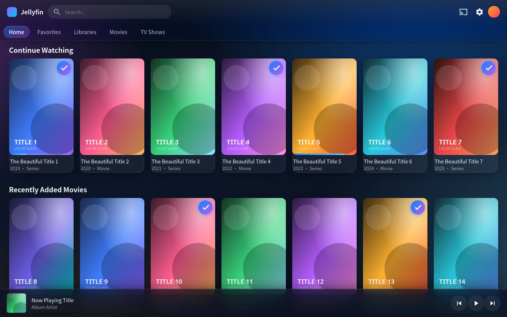 | 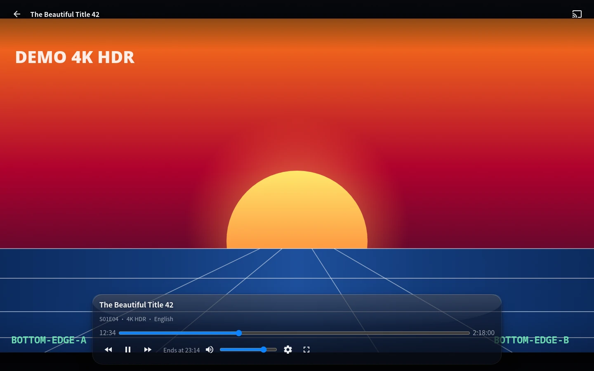 |

---

## 简体中文

### 这是什么？

Liquid Glass 是一个 **Jellyfin 网页客户端主题**（自定义 CSS）。它把默认的扁平深色界面换成 iOS 26 风格的「液态玻璃」：极光渐变背景、分层毛玻璃、镜面高光、同心圆角、内容自适应色调。

整个主题就是一个 `liquid-glass.css` 文件，通过 Jellyfin 自带的「自定义 CSS」入口加载 —— **不需要插件、不需要改服务端、不需要换 Docker 镜像、不需要重新打包客户端**。

### 适合谁？

- 觉得 Jellyfin 默认界面太「工具感」、想要更精致观感的人
- 在电视、投影或大屏上看片，希望界面不要抢画面的人
- 手机 / 平板 / 桌面 / TV 混用的家庭
- 低配设备或 NAS 用户（主题只对少数悬浮层做实时模糊，滚动开销很小）

### v4 修复了什么：播放时底部玻璃挡住画面

v3 把播放器底部控制区做成了整条 `rgba(9,12,22,0.72)` + `blur(16px)` 的毛玻璃板。但 Jellyfin 的 `.videoOsdBottom` 自带 `padding-top: 7.5em` —— 这块留白原本是给「透明渐变遮罩」用的，变成实心玻璃后就成了 7.5em 高的磨砂板。

实测（1440×900）：控制条本身只有 171px 高，玻璃板却高达 **293px**，把画面下三分之一整块盖住，还带一条生硬的顶边。手机竖屏更严重（343px）。

| v3 — 玻璃挡住画面 | v4 — 玻璃只包住控件 |
| :---: | :---: |
| 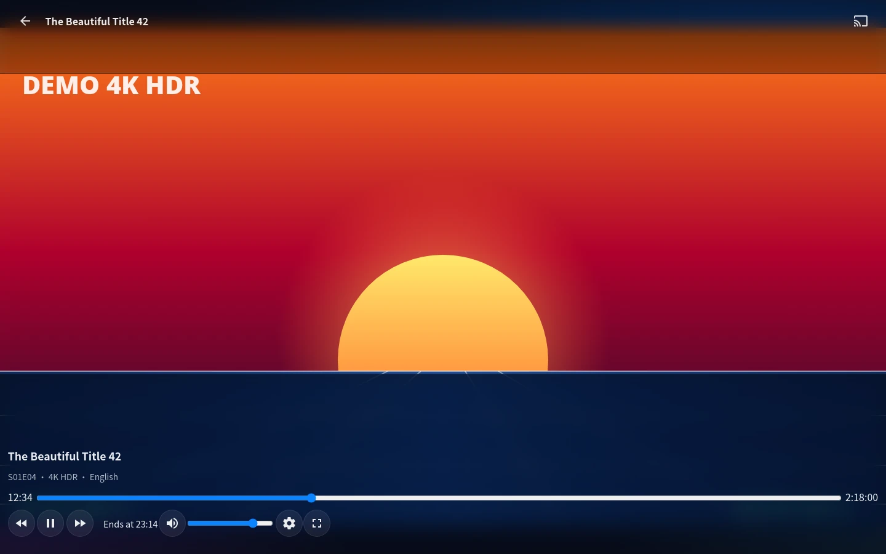 |  |

v4 的改法：

- `.videoOsdBottom` 退回**纯遮罩**：只留一层很淡的线性渐变，`backdrop-filter: none`、`border-top: 0`、`padding-top: 1.5em`
- 玻璃只加在真正装控件的 `.osdControls` 上：居中、最大 `62rem` 的悬浮胶囊，圆角 `1.5rem`
- 控件隐藏时（`.videoOsdBottom-hidden`）额外关掉 `backdrop-filter` —— iOS/WebKit 在 `opacity: 0` 时仍会保留模糊层
- 同时修掉 v3 的第二个 bug：顶栏规则误伤了播放器的 `.skinHeader.osdHeader`，在画面顶部压了一条实心条。现在所有顶栏规则都写成 `.skinHeader:not(.osdHeader)`

实测结果：桌面 1440×900 下玻璃高度从 293px 降到 **211px**，手机从 343px 降到 **235px**，画面下沿完全可见。

### 功能

- **极光背景**：四层径向渐变 + 线性底色的深空渐变
- **玻璃只给悬浮层**：顶栏、抽屉、弹窗、登录卡、播放器控件 —— 卡片 / 按钮 / 列表用半透明纯色 + 内描边高光，不做实时模糊，因此滚动不掉帧
- **同心圆角体系**：子元素圆角 = 父级圆角 − 内边距
- **胶囊主按钮**与悬停提亮（只动 `transform`，不触发图片重绘）
- **iOS 风格分组内嵌列表**（设置页）
- **响应式**：手机 / 平板 / 折叠屏展开与折叠 / 桌面 / TV 各自一套布局
- **安全区域适配**：刘海屏、`env(safe-area-inset-*)`
- **无障碍**：≥44px 触控目标、TV 焦点环、`prefers-reduced-transparency` / `prefers-reduced-motion` / `prefers-contrast` 全部尊重
- **图标乱码修复**：内置全量 Material Icons 字形映射（2178 条规则），修掉 Safari / 部分 WebView 下图标显示成 `` 的 Latin-1 解码问题 —— 与文件编码无关，纯 CSS 实现

### Jellyfin 12.x 现代布局

12.x 的网页端默认换成了一套基于 React + MUI 的新界面：顶栏是 `MuiAppBar`，抽屉是 `MuiDrawer`，弹窗是 `MuiDialog`，菜单是 `MuiMenu` —— 这些类名和 10.x 的 `.skinHeader` / `.mainDrawer` / `.dialog` 完全不是一套。v4.1 起把**同一套玻璃语言补到了这批 MUI 组件上**，所以新旧两种布局看起来是一致的，而不是「老界面是玻璃、新界面是裸的」。

| 12.4 桌面首页 | 12.4 手机抽屉 |
| :---: | :---: |
| 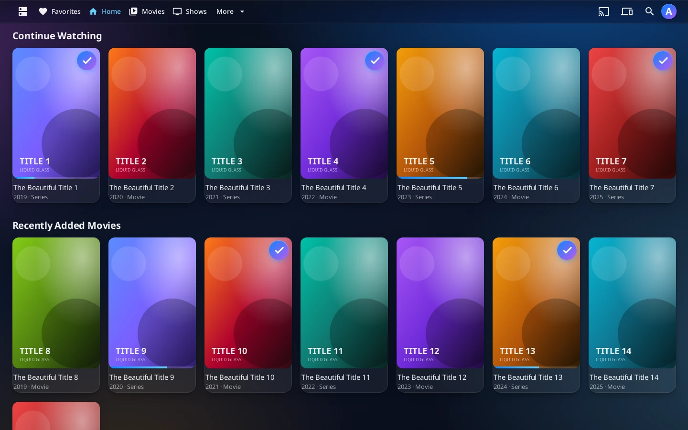 | 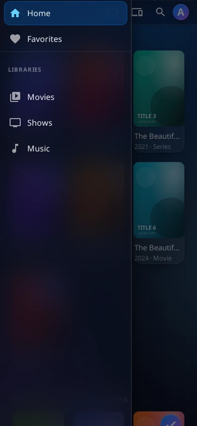 |

| 12.4 播放界面 | 12.4 弹窗 |
| :---: | :---: |
| 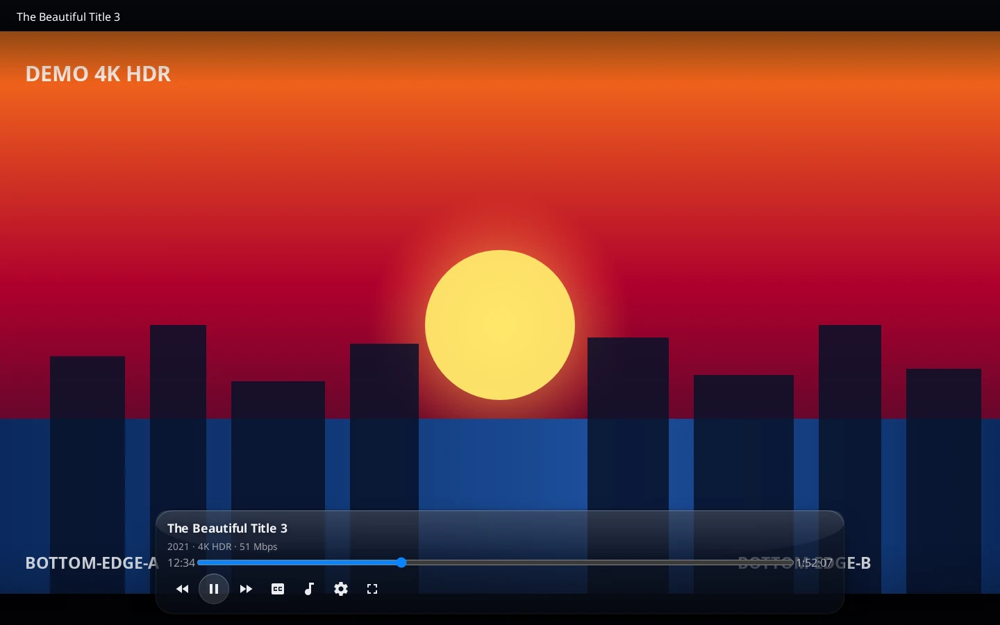 | 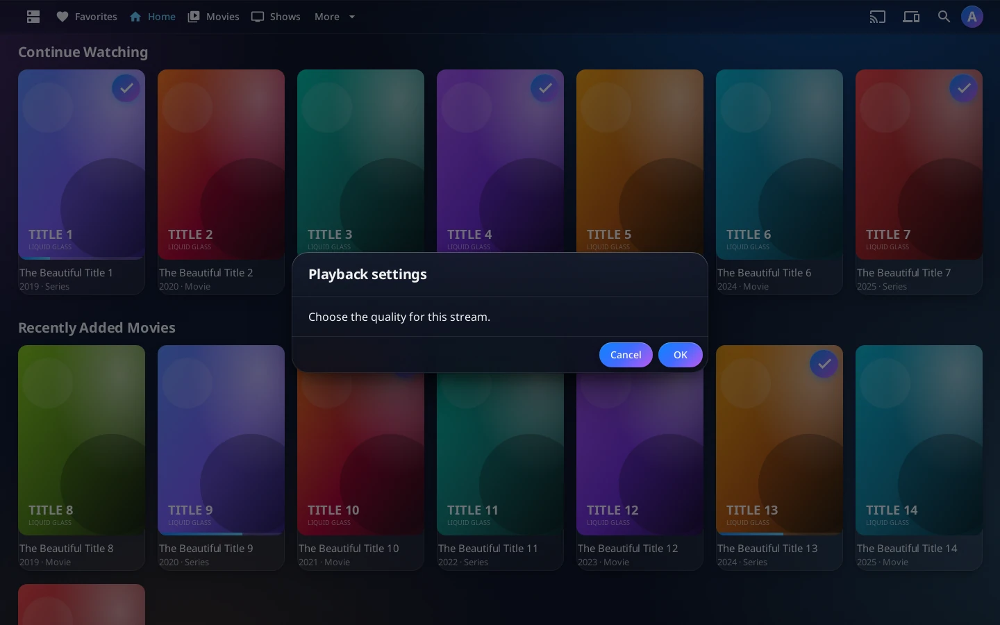 |

> 12.4 的播放页在 DOM 上是「新的 React 外壳 + 旧的播放器视图」：顶栏那个 `<AppBar>` 依然存在，但里面是空的（`AppToolbar` 对 `/video` 直接 `return null`）。主题用 `body:has(.videoPlayerContainer) .MuiAppBar-root` 把这条空栏彻底关掉，避免在画面上方留下一条玻璃带。

### 安装

**方式一（推荐，锁定版本）** —— 仪表盘 → 常规 → 品牌 → 自定义 CSS，粘贴：

```css
@import url("https://cdn.jsdelivr.net/gh/aoxzh/jellyfin-liquid-glass@v4.1.0/liquid-glass.css");
```

**方式二（离线 / 内网无外网）** —— 下载 [`liquid-glass.css`](liquid-glass.css)，把整个文件内容粘贴进同一个「自定义 CSS」框。这是最稳的方式：不依赖任何 CDN，也不会有缓存不同步的问题。

**方式三（跟随上游）** —— 把上面的 `@v4.1.0` 换成 `@main`。注意 jsDelivr 对分支名有最长约 12 小时的缓存，刚发新版时可能还拿到旧文件；遇到这种情况改用方式一或方式二。

保存后刷新页面（`Ctrl/Cmd + Shift + R`）即可生效。

### 兼容性

| Jellyfin 版本 | 状态 | 说明 |
| --- | --- | --- |
| 10.9.x | ✅ | 基于 `.videoOsdBottom` / `.osdControls` 经典类名 |
| 10.10.x | ✅ | 同上，播放器 DOM 未变 |
| 12.x | ✅ | 已在 **12.4.0** 实测，**默认的现代布局（MUI）和经典布局都做了适配**：MUI 顶栏 / 抽屉 / 弹窗 / 菜单换成同一套玻璃，播放页不再有顶栏压画面 |
| 网页端（浏览器） | ✅ | Chrome / Edge / Firefox / Safari |
| Android / iOS App | ✅ | 内置 WebView 走同一套 CSS |
| Android TV / 电视端 | ✅ | 额外有 `.layout-tv` 焦点环优化 |

需要浏览器支持 `backdrop-filter`（Chrome 76+、Safari 9+、Firefox 103+）。不支持的浏览器会自动降级为半透明纯色，功能不受影响。

### 常见问题

**问：装完之后界面没变化？**

答：Jellyfin 的自定义 CSS 有缓存。先硬刷新（`Ctrl/Cmd + Shift + R`），再确认代码是贴在 **仪表盘 → 常规 → 品牌 → 自定义 CSS** 而不是别的地方；用 `@import` 方式时注意必须放在文件第一行。

**问：播放视频时底部还有一条模糊的东西挡画面？**

答：v4 已修复。如果你看到的是 v3 的效果，说明浏览器缓存了旧 CSS —— 清缓存或改用带版本号的 `@import` 地址。

**问：升级到 Jellyfin 12.4 后播放黑屏、只有声音？**

答：这是 **v4.0.0 的 bug**，已在 **v4.0.1** 修复，不是 Jellyfin 的问题。原因：jellyfin-web 把 `<video>` 放在 `body` 的第一个子节点 `.videoPlayerContainer`（`position:fixed`），而播放 OSD 页 `#videoOsdPage` 在 DOM 里排在它之后、两者都是 `z-index:auto`，所以 OSD 页永远画在视频上层 —— 官方就是靠这个页面**全透明**让画面透出来的。v4.0.0 给它加了 `background:#000`，结果整块画面被盖成纯黑、声音照常播放。v4.0.1 已改回全透明。把 `@import` 地址里的 tag 换成 `@v4.1.0`（或清一次缓存）即可。

**问：会不会影响播放性能？**

答：不会。整个文件只有 **7 条规则**真正启用实时模糊（玻璃配方 / 播放器控制胶囊 / 底部播放条，以及 12.x 现代布局的顶栏、抽屉、弹窗、菜单），且都作用在小面积悬浮层上；卡片、按钮、列表全部使用半透明纯色 + 内描边，不参与模糊。过渡动画只动 `transform` / `opacity` / `background-color`，时长 ≤0.24s。

**问：能只改配色不改布局吗？**

答：可以。所有颜色都收在文件顶部的 `:root` 设计令牌里（`--lg-accent`、`--lg-panel`、`--lg-text` 等），改令牌即可换配色，不必动下面的规则。

**问：支持浅色主题吗？**

答：目前是深色单主题。`:root` 里声明了 `color-scheme: dark`，浅色版本在规划中。

**问：图标变成乱码怎么办？**

答：本主题已内置 2178 条 Material Icons 字形修复规则，正常情况下不会再出现。若仍有乱码，通常是别的自定义 CSS 覆盖了 `font-family`。

### 截图

截图来自项目自建的 mock 界面（**不含任何真实媒体库数据**），用于在没有服务器的环境下验证主题效果。

| 桌面首页 | 详情页 |
| :---: | :---: |
|  | 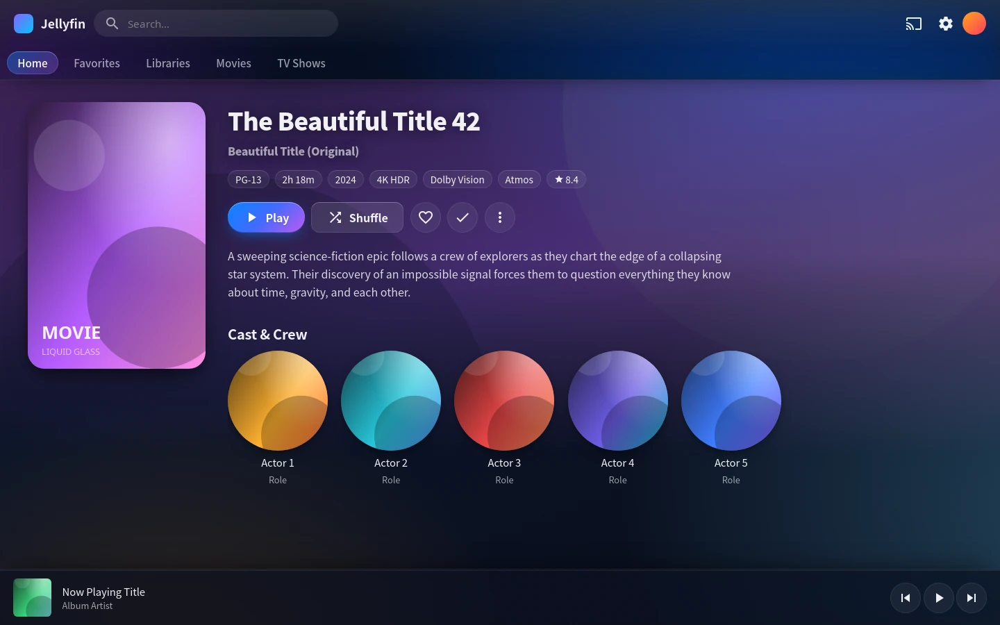 |

| 设置页 | 弹窗 |
| :---: | :---: |
| 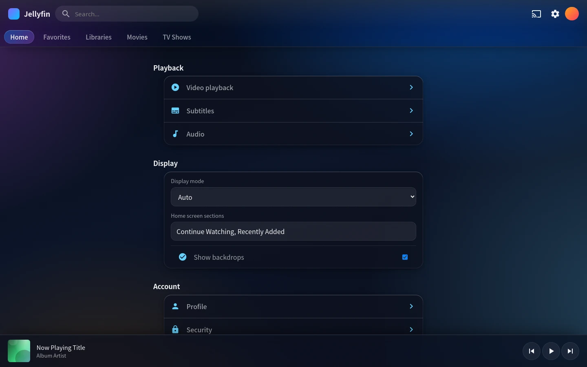 | 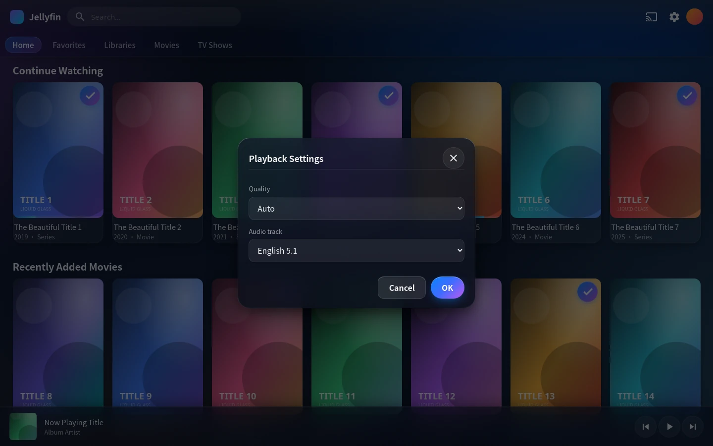 |

| 登录页 | 电视端 1080p |
| :---: | :---: |
| 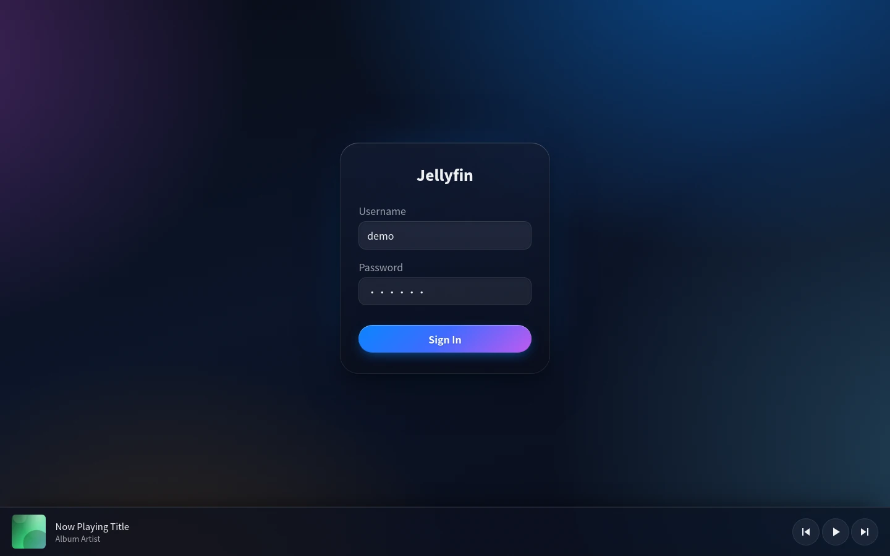 | 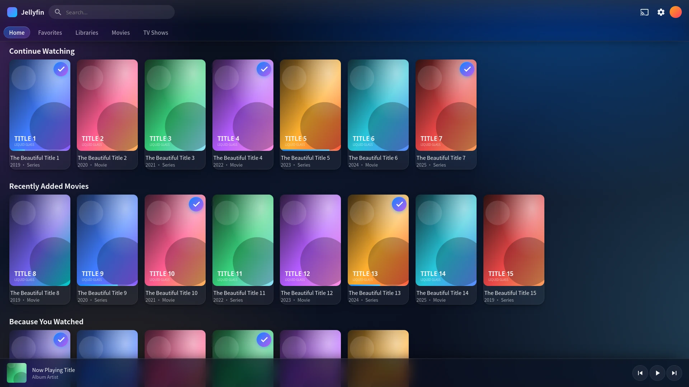 |

| 手机 390×844 | 平板 834×1112 |
| :---: | :---: |
| 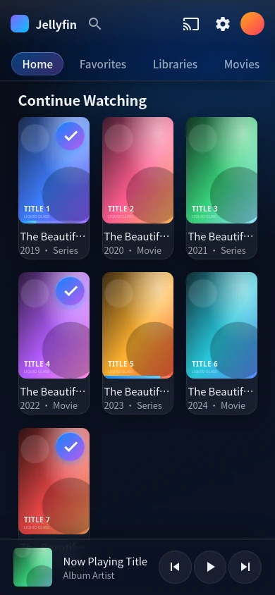 | 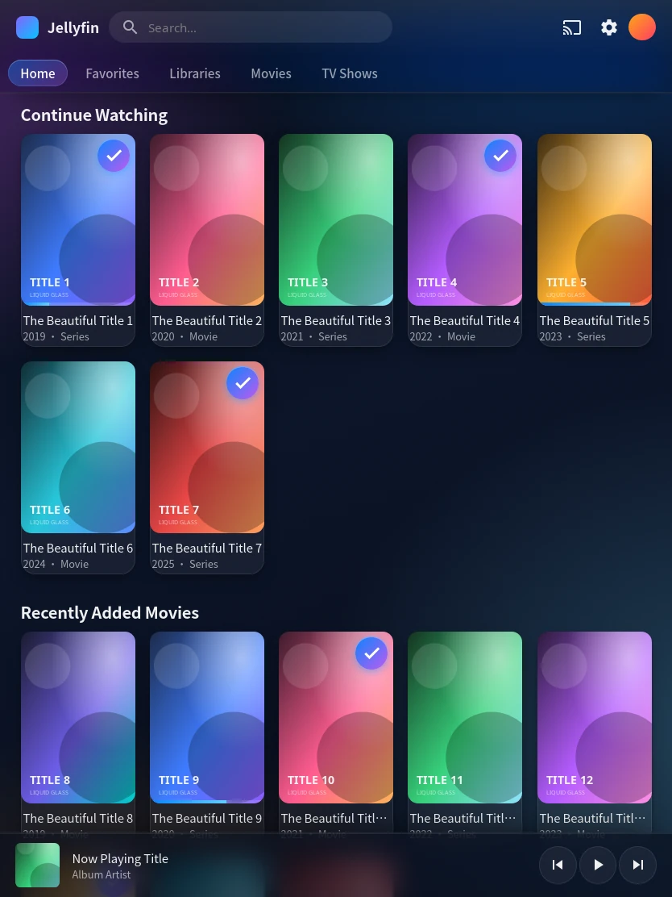 |

| 手机播放界面 |
| :---: |
| 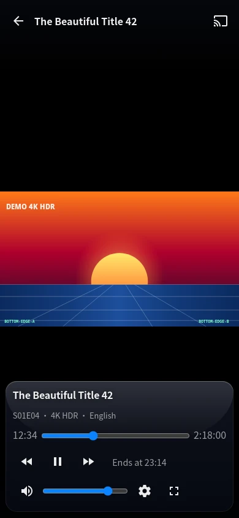 |

| 12.4 桌面（MUI 顶栏） | 12.4 手机 |
| :---: | :---: |
|  | 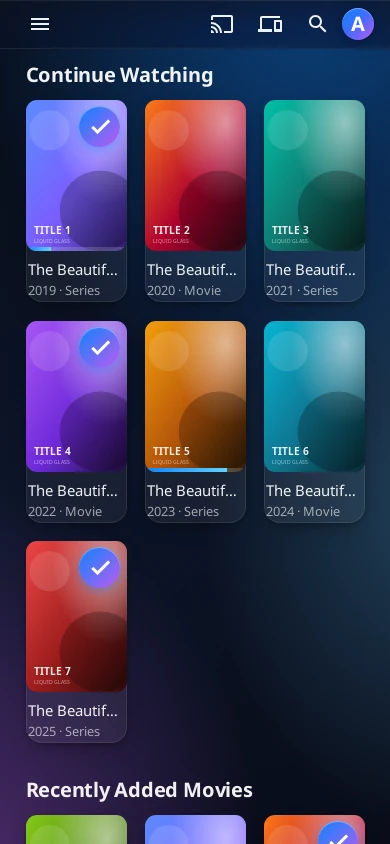 |

### 文件结构

```
liquid-glass.css              # 主题本体（3854 行，单文件，无外部依赖）
docs/screenshots/*.webp       # 截图
docs/schema.jsonld            # Schema.org 结构化数据（SoftwareApplication + FAQPage）
llms.txt                      # 给 AI 引擎的内容索引
llms-full.txt                 # 完整可引用文本
```

### 许可证

MIT © [aoxzh](https://github.com/aoxzh)

---

## English

### What is this?

Liquid Glass is a **custom CSS theme for the Jellyfin web client**. It replaces Jellyfin's flat dark UI with an iOS 26-style "liquid glass" look: an aurora gradient backdrop, layered frosted panels, specular highlights, concentric corner radii, and content-adaptive tinting.

The whole theme is a single `liquid-glass.css` file loaded through Jellyfin's built-in **Custom CSS** box — **no plugin, no server patch, no custom Docker image, no client rebuild**.

### Who is it for?

- People who find Jellyfin's default UI too utilitarian and want something more polished
- Home-theatre setups on a TV or projector where the UI should never fight the picture
- Households mixing phones, tablets, desktops and TVs
- Low-power NAS and mini-PC users — blur is applied to a handful of floating layers only

### What v4 fixes: the playback overlay covering the video

v3 turned the player's bottom OSD into a full-width frosted slab: `rgba(9,12,22,0.72)` plus `blur(16px)`. But Jellyfin's `.videoOsdBottom` carries `padding-top: 7.5em`, which exists to give the *transparent* gradient scrim some room. Once the scrim became opaque glass, that 7.5em padding turned into a solid frosted block.

Measured at 1440×900: the controls are 171px tall, but the glass slab was **293px** — covering the bottom third of the frame with a hard top edge. On a 390×844 phone it was 343px.

| v3 — glass covers the picture | v4 — glass wraps the controls only |
| :---: | :---: |
|  |  |

How v4 fixes it:

- `.videoOsdBottom` is back to a **pure scrim**: a faint linear gradient only, `backdrop-filter: none`, `border-top: 0`, `padding-top: 1.5em`
- Glass moves onto `.osdControls`, the element that actually holds the buttons: a centred floating capsule capped at `62rem` with `1.5rem` radii
- The hidden state (`.videoOsdBottom-hidden`) also disables `backdrop-filter`, because iOS/WebKit keeps the blur layer alive at `opacity: 0`
- Second v3 bug fixed at the same time: the header rules leaked onto the player's `.skinHeader.osdHeader`, painting a solid bar across the top of the video. All header rules are now scoped to `.skinHeader:not(.osdHeader)`

Result: the glass is **211px** tall at 1440×900 (was 293px) and **235px** on a phone (was 343px), and the bottom edge of the picture stays visible.

### Features

- **Aurora backdrop** — four radial gradients over a deep-space linear base
- **Glass on floating layers only** — header, drawer, dialogs, login card, player controls. Cards, buttons and lists use translucent solids plus an inner stroke highlight and never trigger live blur, so scrolling stays smooth
- **Concentric radii** — child radius = parent radius − padding
- **Capsule primary buttons** with hover lift (transform only, no image re-rasterisation)
- **iOS-style grouped inset lists** on settings pages
- **Responsive** — separate layouts for phone, tablet, folded/unfolded foldables, desktop and TV
- **Safe-area aware** — notches and `env(safe-area-inset-*)`
- **Accessible** — ≥44px touch targets, TV focus rings, honours `prefers-reduced-transparency`, `prefers-reduced-motion` and `prefers-contrast`
- **Icon mojibake fix** — a built-in, encoding-independent rewrite of all 2178 Material Icons glyph rules, fixing icons that render as `` in Safari and some WebViews (Jellyfin serves its icon CSS as raw UTF-8 bytes without a charset, so it gets decoded as Latin-1)

### Jellyfin 12.x modern layout

The 12.x web client defaults to a new React + MUI UI: the top bar is a `MuiAppBar`, the drawer is a `MuiDrawer`, dialogs are `MuiDialog` and menus are `MuiMenu` — none of which are the `.skinHeader` / `.mainDrawer` / `.dialog` class names of 10.x. Since v4.1 the **same glass language is applied to those MUI components too**, so the old and new layouts look like one theme instead of "glass on the old UI, bare stock on the new one".

| 12.4 desktop home | 12.4 mobile drawer |
| :---: | :---: |
|  |  |

| 12.4 player | 12.4 dialog |
| :---: | :---: |
|  |  |

> On 12.4 the player is a "new React shell around the legacy player view": the `<AppBar>` still exists but is empty (`AppToolbar` does `return null` for `/video`). The theme removes that empty bar with `body:has(.videoPlayerContainer) .MuiAppBar-root`, so no glass strip is left across the top of the picture.

### Install

**Option 1 (recommended, pinned)** — Dashboard → General → Branding → Custom CSS, paste:

```css
@import url("https://cdn.jsdelivr.net/gh/aoxzh/jellyfin-liquid-glass@v4.1.0/liquid-glass.css");
```

**Option 2 (offline / no internet on the server)** — download [`liquid-glass.css`](liquid-glass.css) and paste the entire file into the same Custom CSS box. This is the most robust route: no CDN involved and no cache to fall out of sync.

**Option 3 (tracks upstream)** — replace `@v4.1.0` above with `@main`. Note that jsDelivr caches branch names for up to ~12 hours, so right after a release you may still receive the previous file; if that happens, use Option 1 or 2.

Save, then hard-refresh (`Ctrl/Cmd + Shift + R`).

### Compatibility

| Jellyfin version | Status | Notes |
| --- | --- | --- |
| 10.9.x | ✅ | Built on the classic `.videoOsdBottom` / `.osdControls` class names |
| 10.10.x | ✅ | Player DOM unchanged |
| 12.x | ✅ | Verified on **12.4.0**, and **both the default modern (MUI) layout and the legacy layout are themed**: the MUI app bar, drawer, dialog and menu become the same glass, and nothing is painted over the video while playing |
| Web (browser) | ✅ | Chrome / Edge / Firefox / Safari |
| Android / iOS app | ✅ | Their embedded WebView loads the same CSS |
| Android TV / TV clients | ✅ | Extra `.layout-tv` focus-ring tuning |

Requires `backdrop-filter` support (Chrome 76+, Safari 9+, Firefox 103+). Browsers without it fall back to translucent solids automatically; nothing breaks.

### FAQ

**The UI didn't change after I installed it.**

Jellyfin caches custom CSS. Hard-refresh first (`Ctrl/Cmd + Shift + R`), confirm the code is in **Dashboard → General → Branding → Custom CSS**, and if you use `@import` make sure it is the very first line of the box.

**There is still a blurry bar covering the bottom of the video while playing.**

That is the v3 behaviour, fixed in v4. If you still see it, your browser is serving cached CSS — clear the cache or switch to a versioned `@import` URL.

**Black screen with audio only after upgrading to Jellyfin 12.4?**

That was a **v4.0.0 bug**, fixed in **v4.0.1** — not a Jellyfin problem. jellyfin-web inserts the `<video>` element as `body`'s first child (`.videoPlayerContainer`, `position:fixed`), while the playback OSD page `#videoOsdPage` comes later in DOM order and both are `z-index:auto` — so the OSD page always paints above the video. Upstream relies on that page being fully **transparent**. v4.0.0 gave it `background:#000`, which covered the whole picture while audio kept playing. v4.0.1 restores full transparency. Point your `@import` at `@v4.1.0` (or clear the cache) to update.

**Does it hurt playback performance?**

No. Only **seven rules** in the file enable live blur — the shared glass recipe, the player control capsule, the audio now-playing bar, and the four MUI surfaces of the 12.x modern layout (app bar, drawer, dialog, menu/popover). All of them apply to small floating surfaces. Cards, buttons and lists are translucent solids with an inner stroke and never blur. Animations only touch `transform`, `opacity` and `background-color`, with durations ≤0.24s.

**Can I change the colours without touching the layout?**

Yes. Every colour lives in the `:root` design tokens at the top of the file (`--lg-accent`, `--lg-panel`, `--lg-text`, …). Override the tokens and leave the rules alone.

**Is there a light theme?**

Not yet. The theme declares `color-scheme: dark`; a light variant is planned.

**Icons render as garbage characters.**

The theme ships 2178 Material Icons glyph rules that fix this. If it still happens, another custom CSS file is probably overriding `font-family`.

### Screenshots

Captured from the project's own mock UI (**no real library data**) so the theme can be verified without a running server.

| Desktop home | Detail page |
| :---: | :---: |
|  |  |

| Settings | Dialog |
| :---: | :---: |
|  |  |

| Login | TV 1080p |
| :---: | :---: |
|  |  |

| Mobile 390×844 | Tablet 834×1112 |
| :---: | :---: |
|  |  |

| Mobile playback |
| :---: |
|  |

| 12.4 desktop (MUI app bar) | 12.4 mobile |
| :---: | :---: |
|  |  |

### Repository layout

```
liquid-glass.css              # the theme (3854 lines, single file, no dependencies)
docs/screenshots/*.webp       # screenshots
docs/schema.jsonld            # Schema.org structured data (SoftwareApplication + FAQPage)
llms.txt                      # content index for AI engines
llms-full.txt                 # full quotable text
```

### License

MIT © [aoxzh](https://github.com/aoxzh)
